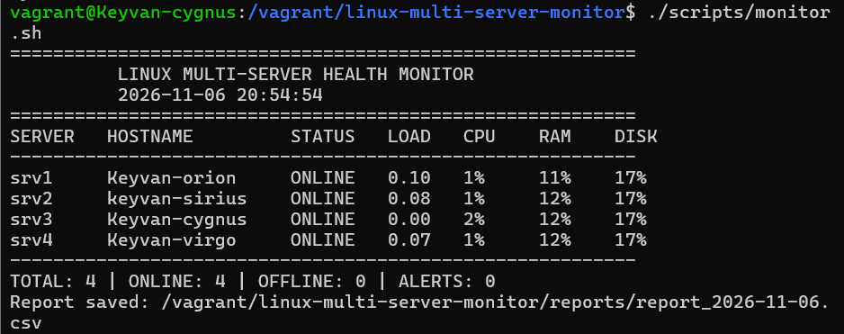
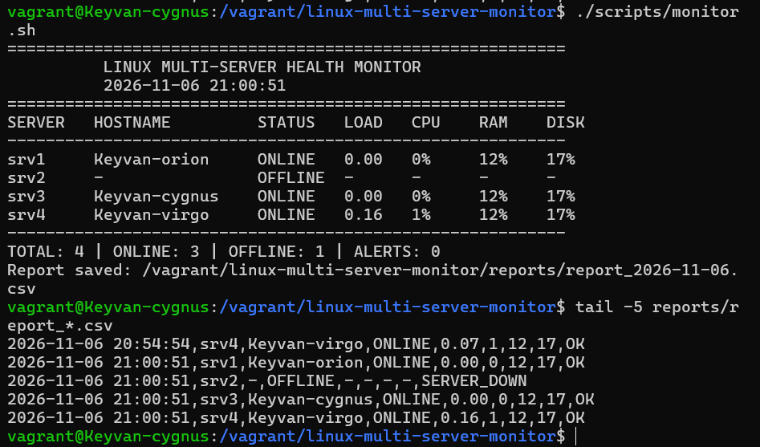
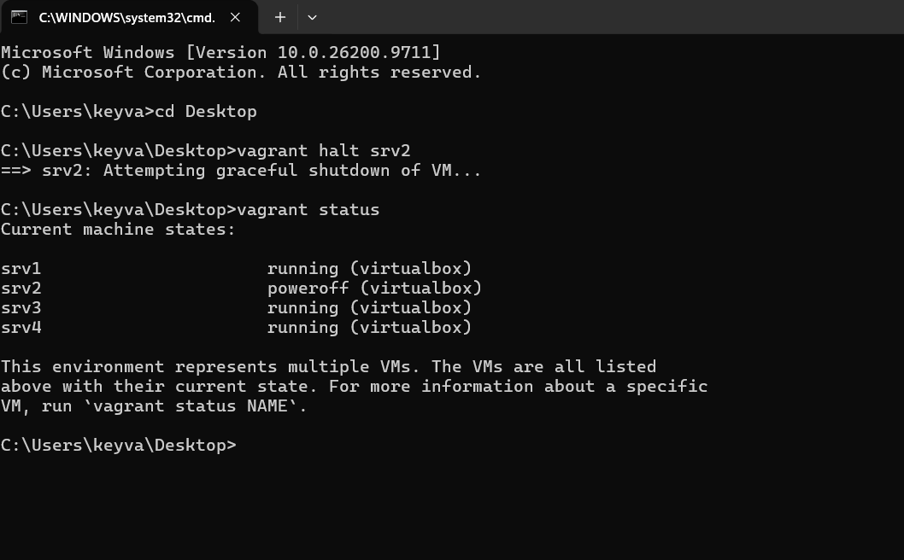
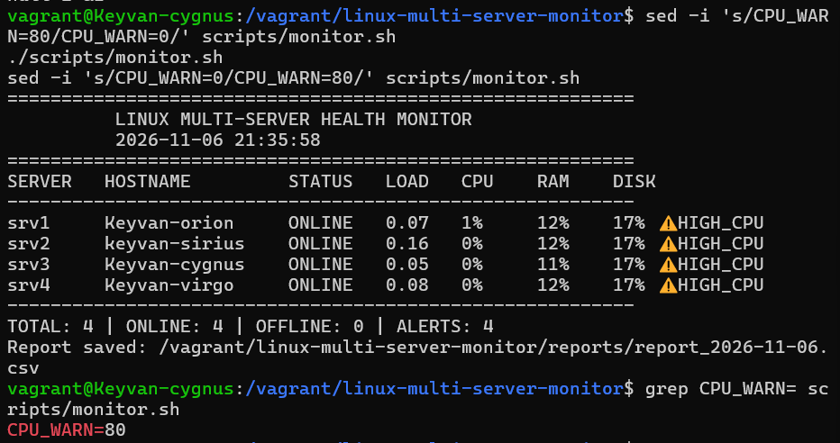
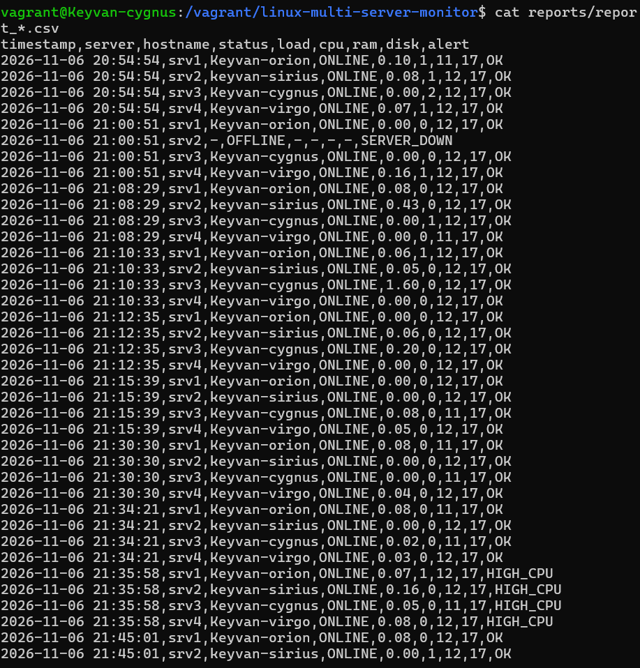

# Linux Multi-Server Monitoring Tool

A lightweight Bash-based monitoring tool that checks the health of multiple Linux servers over SSH and generates console and CSV reports. Built as a hands-on DevOps / Linux administration project using Vagrant and VirtualBox.

## Features

- Monitors 4 Ubuntu 22.04 servers from a single controller node
- Passwordless SSH authentication (Ed25519 keys)
- Real CPU usage calculated from `/proc/stat` (1-second sampling)
- RAM, disk, and load average reporting
- Online / Offline detection with SSH timeout
- Threshold alerts for CPU, RAM and disk
- Daily CSV reports for history and analysis
- Automated runs every 5 minutes with cron

## Screenshots

### Normal run (4/4 servers online)


### Offline detection (srv2 stopped)


### Recovery (srv2 restarted, 4/4 VMs running)


### Threshold alert


### CSV report


## Architecture

```
            +------------------------+
            |  srv3 (Controller)     |
            |  monitor.sh + cron     |
            +-----------+------------+
                        | SSH (key auth)
        +---------------+---------------+
        |               |               |
     srv1            srv2            srv4
```

The controller runs `monitor.sh`, which streams `collect-metrics.sh` to each server over SSH, collects one line of metrics per server, and builds the report.

## Project Structure

```
linux-multi-server-monitor/
├── scripts/
│   ├── monitor.sh            # main script
│   └── collect-metrics.sh    # runs on each server
├── config/
│   └── servers.conf.example  # server list template
├── reports/                  # generated reports (git-ignored)
├── screenshots/
├── .gitignore
└── README.md
```

## Setup

1. Create the servers (Vagrant + VirtualBox, or any Linux hosts).
2. On the controller, generate an SSH key and copy it to every server:

```bash
ssh-keygen -t ed25519 -C "monitoring-controller"
ssh-copy-id user@SERVER_IP
```

3. Create your server list from the template:

```bash
cp config/servers.conf.example config/servers.conf
```

Format: `name:ip`, and use `local` for the controller itself.

4. Run the monitor:

```bash
chmod +x scripts/*.sh
./scripts/monitor.sh
```

5. (Optional) Schedule with cron:

```
*/5 * * * * /path/to/linux-multi-server-monitor/scripts/monitor.sh >> /path/to/reports/cron.log 2>&1
```

## Example Output

```
==========================================================
          LINUX MULTI-SERVER HEALTH MONITOR
          2026-11-06 21:00:51
==========================================================
SERVER   HOSTNAME         STATUS   LOAD   CPU    RAM    DISK
----------------------------------------------------------
srv1     Keyvan-orion     ONLINE   0.00   0%     12%    17%
srv2     -                OFFLINE  -      -      -      -
srv3     Keyvan-cygnus    ONLINE   0.00   0%     12%    17%
srv4     Keyvan-virgo     ONLINE   0.16   1%     12%    17%
----------------------------------------------------------
TOTAL: 4 | ONLINE: 3 | OFFLINE: 1 | ALERTS: 0
```

## Testing

| Test | Method | Result |
|------|--------|--------|
| Normal run | All VMs running | 4/4 ONLINE |
| Offline detection | `vagrant halt srv2` | srv2 reported OFFLINE, others unaffected |
| Recovery | `vagrant up srv2` | srv2 back ONLINE |
| CPU measurement | CPU load generated with busy loops | Measured 64% on the controller |
| Alerts | Threshold temporarily lowered to 0 | All servers flagged HIGH_CPU |
| Automation | cron every 5 minutes | Reports generated automatically |

Note: alert logic was verified by lowering the threshold, not by sustained real CPU load.

## Default Thresholds

| Metric | Threshold |
|--------|-----------|
| CPU | 80% |
| RAM | 80% |
| Disk | 85% |

Edit these values at the top of `scripts/monitor.sh`.

## Security Notes

- Private keys are never committed.
- `config/servers.conf` (real IPs) and reports are git-ignored.
- Use a dedicated, least-privilege user for monitoring in production.

## Ideas for Improvement

- Email / Slack alerts
- Web dashboard
- Parallel SSH checks for larger fleets
- Systemd timer instead of cron

## Skills Demonstrated

Linux administration, Bash scripting, SSH key authentication, networking (multi-subnet), cron automation, Vagrant / VirtualBox, Git & GitHub.

## License

MIT
